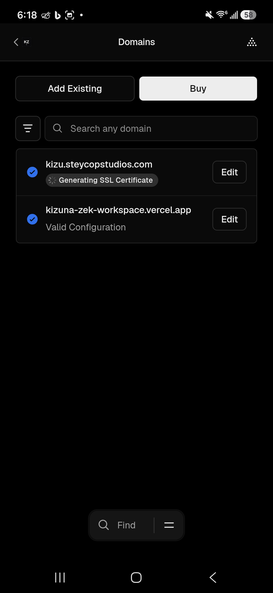
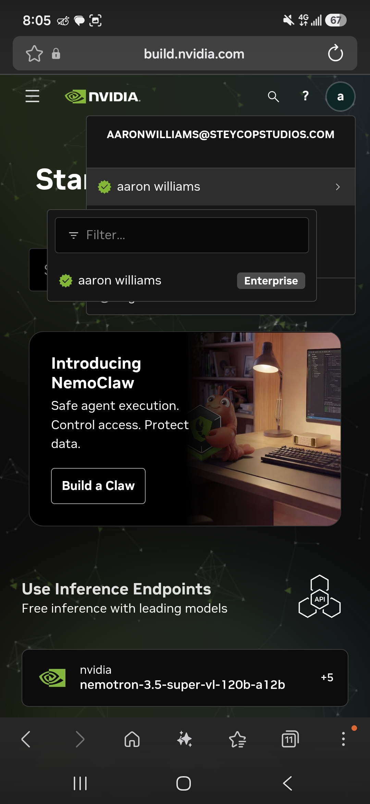

# Kizuna-Zek AI Studio (Kizu) 🌌✍️

[](https://react.dev)
[](https://www.typescriptlang.org)
[](https://tailwindcss.com)
[](https://www.alibabacloud.com/help/en/model-studio)
[](LICENSE)

> **Idiomas**: [English](README.md) | [Español](README.es.md)

**Kizuna-Zek AI Studio** (abreviada como **"Kizu"**) es una plataforma de escritura asistida por IA de alto rendimiento, diseñada para la creación de narrativa compleja, literatura de drama psicológico y gestión de Lore en tiempo real.

---

## 🌐 Dominio Oficial en Producción

* **Dominio Personalizado Principal**: [https://kizu.steycopstudios.com](https://kizu.steycopstudios.com)
* **Página de Lanzamiento / Startup Showcase**: [https://kizu.steycopstudios.com?view=landing](https://kizu.steycopstudios.com?view=landing)

---

## 🚀 Postulación al Alibaba Cloud AI Catalyst Program

Kizuna-Zek está optimizado arquitectónicamente para la postulación al **Alibaba Cloud AI Catalyst Program ($120k Grant Application)**.

* **Motor Principal**: Alibaba Cloud Model Studio (`qwen3.8-max` vía proxy SSE compatible con OpenAI).
* **Motor Secundario**: Google Gemini API (`gemini-3.6-flash`).
* **Motor Fallback**: NVIDIA NIM Microservices (`stepfun-ai/step-5-preview`).
* **Landing Page**: Vista interactiva en pantalla completa accesible desde `?view=landing`.

---

## 💡 Etimología y Visión

El nombre combina **"Kizuna"** (絆 - *vínculo/ancla indeleble*) y el apellido del protagonista de la historia, **Kolder Zekshoyu**. Además, el apodo **"Kizu"** (傷 - *herida* en japonés) simboliza el enfoque central en el drama psicológico, la extirpación límbica y la resiliencia de los personajes.

---

## ✨ Capacidades y Características Clave

### 1. Arquitectura Dual-Engine con Auto-Router Resiliente
* **Conmutación sin caídas**: Alterna automáticamente entre Alibaba Cloud Model Studio, Google Gemini y NVIDIA NIM cuando ocurren cuellos de botella o cuotas agotadas.
* **Visualización de Razonamiento CoT**: Aísla los bloques de pensamiento interno (*Chain-of-Thought*) con el indicador ("💧 Pensado durante..."), colapsados por defecto para mantener limpio el lienzo de lectura.

### 2. Escudo de Tokens 2K y Optimización de Contexto
* **Ventana de Contexto Inteligente**: Comprime la lore y memorias a una huella de ~2,000 tokens, preservando la calidad narrativa mientras minimiza costos de facturación.
* **Sanitización de Streaming SSE**: Limpieza en tiempo real de fragmentos de tokens de parada residuales (`<`, `<|im_end|>`).

### 3. Motor de Visión 8K Zero-Copy y Storyboard de Video
* **Compresor Adaptativo 8K Client-Side**: Redimensiona fotos de 4K/8K/200MP vía `ObjectURL` zero-copy con mipmapping progresivo a 2x y alineación a la cuadrícula de parches del Vision Transformer (ViT 28x28), manteniendo las cargas por debajo de 750 KB sin borrosidad ni errores HTTP 413.
* **Extractor Universal de Storyboard de Video de 4 Cuadros**: Decodifica archivos MP4/WebM/MOV localmente usando el decodificador de hardware GPU del dispositivo (`MediaCodec` / `VideoToolbox`), extrayendo 4 fotogramas clave (#1 al 8%, #2 al 36%, #3 al 64%, #4 al 92%) en un tablero HD 2×2 (< 680 KB). Permite que **Qwen3.8-Max, Qwen-VL, Gemini y Kimi** analicen secuencias de video completas con cero consumo de ancho de banda de servidor y un costo mínimo de ~1,200 tokens.

### 4. Sistema de Diseño OpenWebUI Dark Noir
* **Tema Dark Noir Predeterminado** (`#09090b`) con conmutador UI Día/Noche.
* **Experiencia Mobile-First**: Blancos de toque mínimos de 44×44px y prevención de zoom automático en móviles (`text-[16px] md:text-sm`).

### 5. Gestor de Lore Canon y Exportación EPUB
* **Biblioteca de Lore Interactiva**: Gestión en tiempo real de fichas de personajes, objetos somáticos y ubicaciones.
* **Suite Editorial**: Exportación directa a libros electrónicos EPUB, sincronización con Google Drive y copia de seguridad en la nube con Firestore.

---

## 🛠️ Stack Tecnológico

* **Frontend**: React 19, TypeScript, Vite, Tailwind CSS, Lucide Icons, Motion.
* **Servidor / Proxy**: Node.js, Express, TSX, `@google/genai`, `openai` SDK.
* **Base de Datos y Auth**: IndexedDB (persistencia local), Firebase Firestore, Google Drive API.

---

## ⚡ Guía de Instalación y Uso (Getting Started)

### Requisitos Previos

* Node.js (v18.0.0 o superior)
* npm, pnpm o bun

### 1. Clonar el Repositorio

```bash
git clone https://github.com/aaronthw44-create/kizuna-zek-workspace.git
cd kizuna-zek-workspace
```

### 2. Instalar Dependencias

```bash
npm install
```

### 3. Configurar Variables de Entorno

Crea un archivo `.env` en la raíz del proyecto copiando `.env.example`:

```bash
cp .env.example .env
```

Agrega tus API Keys en `.env`:

```env
DASHSCOPE_API_KEY=tu_api_key_de_dashscope
DASHSCOPE_BASE_URL=https://ws-sitvcc6ml5lia10m.ap-southeast-1.maas.aliyuncs.com/compatible-mode/v1
GEMINI_API_KEY=tu_api_key_de_gemini
NVIDIA_API_KEY=tu_api_key_de_nvidia
PORT=3000
```

### 4. Iniciar el Servidor de Desarrollo

```bash
npm run dev
```

Abre [http://localhost:3000](http://localhost:3000) en tu navegador.

### 5. Compilar para Producción

```bash
npm run build
npm start
```

---

## 📂 Estructura del Proyecto

```text
├── src/
│   ├── components/
│   │   ├── CompanyLandingModal.tsx  # Landing Page Completa y Muestra para Alibaba Catalyst
│   │   ├── ChatMessage.tsx         # Renderizador de Razonamiento CoT y Texto
│   │   ├── ChatHeader.tsx          # Router Dual-Engine
│   │   ├── Sidebar.tsx             # Navegación y Gestor de Lore
│   │   └── SettingsModal.tsx       # Configuración de Claves y Endpoints
│   ├── utils/
│   │   ├── autoRouter.ts           # Lógica de Conmutación de Motores
│   │   └── directApiStream.ts      # Streaming SSE y Sanitizador de Tokens
│   ├── App.tsx                     # Layout Principal y Estado de React 19
│   └── main.tsx                    # Punto de Entrada de React 19
├── server.ts                       # Servidor Proxy Express (DashScope y Gemini)
├── .env.example                    # Plantilla de Variables de Entorno
├── README.md                       # Documentación Principal (Inglés)
└── README.es.md                    # Documentación en Español
```

---

## 📸 Capturas de Pantalla

| Landing Page Personalizada | Interfaz de Escritura del Studio |
| :---: | :---: |
|  |  |

---

© 2026 Kizuna-Zek AI Studio. Todos los derechos reservados. Creado para autores y literatura de drama psicológico.
